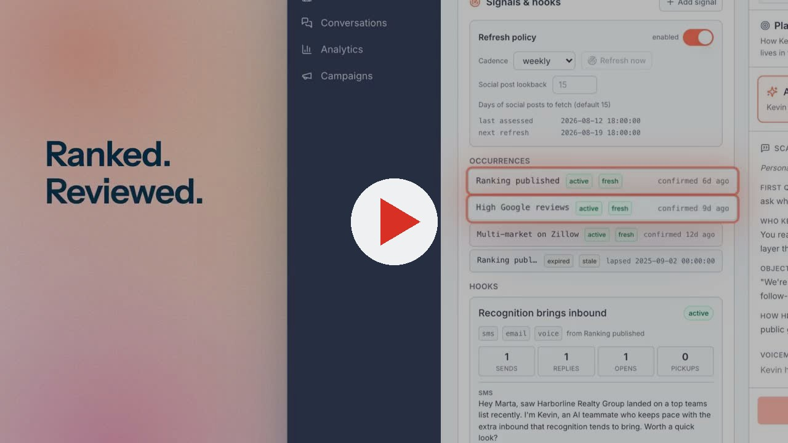
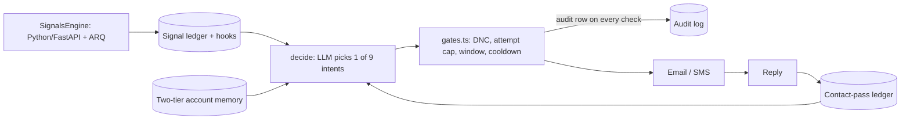

# Felix Sells

### An outbound system where the outreach *is* the demo.

**Click the player above (2 min).** It shows the AI teammate (named Kevin in the demo, on demo data) finding signals, reaching out and booking, plus the operator console behind it. **This README is the other half:** why it works as a product, and the engineering that keeps it safe to run unattended.

> Built at [Fello](https://hifello.com) as primary engineer, with a small team. The code is private; this is the write-up. By [Aryan Pasreja](https://www.linkedin.com/in/aryan-pasreja/).

---

## For founders and operators

**The problem.** Real estate teams are flooded with generic cold outbound, so they ignore it. The most credible way to prove an AI teammate can do inside-sales work is to have it do that work.

**The bet.** Felix writes as himself. He references something true and current about the team (a new listing, a post, a hiring page), never repeats an angle that team has already seen, and asks for a short conversation. Every reply is both a marketing moment and a pipeline event, with no rep hour spent. **Channels:** email and SMS in the live motion. The system began with a Twilio + ElevenLabs voice agent, and the same code-level gates guard every channel.

**Why it's different**
- **Signal-timed, not spray-and-pray.** A touch only goes out when there's a real, source-backed reason.
- **It remembers.** A per-contact ledger records what was said, when and on which channel, and shares that across everyone at the same company.
- **It's safe by construction.** Compliance rules live in code, not policy docs.
- **It tests itself in public.** A built-in A/B system compares openers by reply rate in production.

**How to judge it.** Track close rate on Felix-sourced opportunities, not just volume. Volume that converts worse isn't a win.

---

## For engineers

### Architecture

### The principle: confine the LLM to intent, compute the rest in TypeScript

`decide()` emits a zod-validated action from nine allowed values. Timezone arithmetic, touch spacing, transactional-vs-outreach classification and channel policy are deterministic code.

### Decisions worth reading

- **One audited chokepoint before every send.** Do-not-contact first (cheapest, highest legal stakes), then attempt cap, contact window, cooldown. Every evaluation writes an audit row, bypasses included.
- **Account governor, rolled out shadow → enforce.** It coordinates the buying group, so the owner doesn't get a text the hour the lead gets an email. Behind a flag, opt-in per company, with "no policy set = today's behavior, byte for byte" as the safety contract.
- **Two-tier memory with a privacy wall.** An internal tier informs reasoning but can never be spoken. A separate speakable tier reaches the contact only after a grounding verifier.
- **Personalization engine.** SignalsEngine finds a team's web and social presence from a name and city, scrapes it, and **diffs by content hash before spending model tokens**. It emits scored, source-backed cards with deduplication.
- **A deterministic guard on untrusted text.** When a hook quotes a prospect's own post, a sanitizer plus a 6-word shingle overlap detector runs at hook creation and at send time, even when the LLM verifier is off. Third-party text needs a code-level guard, not a prompt instruction.

### How it's tested

- A **frozen eval suite** for `decide()`: abstention on missing facts, soft-objection reframing, silence-check timing, explicit do-not-contact. Separate evals cover the SMS stylist, hook writer and memory summarizer.
- A **live-agent simulation** verified one fix at 4/4 successful runs against 0/4 for the baseline.
- `pnpm verify` is one pre-push gate: typecheck, lint, unit tests, build and a Playwright smoke of the operator console.
- Staging and production schemas are checked for drift with a documented promotion runbook.

### Lessons I'd repeat

- **Append-biased LLM memory is usually an instruction bug, not a model bug.** The summarizer was told to "preserve all prior touchpoints," so a rescheduled meeting left both times standing. The fix made the structured booking the spine of the memory.
- **"Unknown" and "known to be empty" must be different values to a model.**

---

**Stack:** TypeScript · Next.js / Vite SPA · Supabase (Postgres, RLS) · Python/FastAPI · Twilio SMS · OpenRouter · Railway · Playwright · 1,000+ commits · 100+ migrations · 600+ test files
